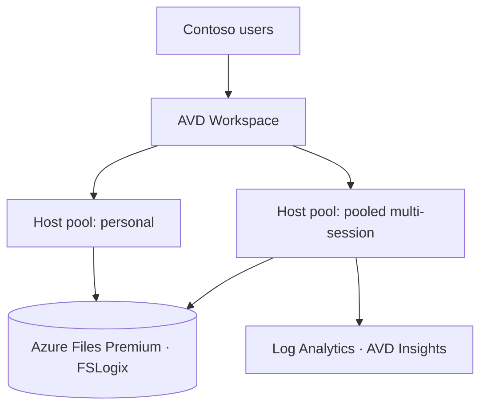

<!-- TEMPLATE — copy to challenges/challenge-02-design/work/hld.md and fill in.
     Control B.2.1 Solution Design. Must match infra/README.md so the IaC implements it 1:1. -->
# Contoso AVD — High-Level Design (B.2.1)

> Author · Date · Version

## 1. Architecture overview

## 2. Design domains

### 2.1 Host pools & application groups
<!-- pooled multi-session + personal per persona; workspace layout; RemoteApp vs desktop;
     load-balancing (breadth/depth). Name the AVM module for each. -->

### 2.2 Identity
<!-- Entra join + Intune default; Conditional Access; RBAC; Entra Kerberos for Files;
     where (if anywhere) hybrid join is required and why. -->

### 2.3 Profiles (FSLogix)
<!-- Files Premium share design, Kerberos, redirections, Cloud Cache?, ANF threshold;
     quota + IOPS sized to §sizing in the assessment. -->

### 2.4 Networking
<!-- hub/spoke, subnets, RDP Shortpath, private endpoints, DNS, peering to on-prem. -->

### 2.5 Golden image
<!-- Azure Image Builder pipeline, source, customisations, versioning, Compute Gallery. -->

### 2.6 Scaling
<!-- scaling plans per persona (time + demand); ramp schedules tuned per workload. -->

### 2.7 Monitoring
<!-- AVD Insights, Log Analytics, alerts on logon time / host health. -->

### 2.8 BCDR
<!-- region strategy, image/profile resilience, RTO/RPO. -->

## 3. AVM module map

| Domain | AVM module | Pinned version |
|---|---|---|
| Host pool | `desktop-virtualization/host-pool` |  |
| App group | `desktop-virtualization/application-group` |  |
| Workspace | `desktop-virtualization/workspace` |  |
| Scaling plan | `desktop-virtualization/scaling-plan` |  |
| Network | `network/virtual-network` |  |
| Storage | `storage/storage-account` |  |
| Monitoring | `operational-insights/workspace` |  |

## 4. Decisions register

| # | Decision | Options considered | Choice | Justification |
|---|---|---|---|---|
| 1 |  |  |  |  |
