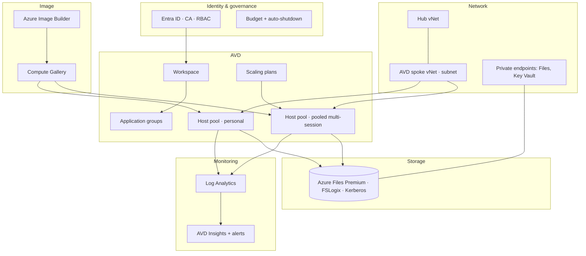

# AVD landing zone — layered reference architecture

## Build order (dependencies)

1. Resource group + tags + **budget/guardrails** (before any VM).
2. Networking (vNet, subnet, NSG, private DNS) + Log Analytics.
3. Storage account + Files Premium share + private endpoint + identity-based access (Kerberos).
4. (Optional in lab) Image: Azure Image Builder → Compute Gallery. Labs may use the
   marketplace Win 11 multi-session image to save time.
5. AVD objects: workspace → host pool(s) → application group(s) → assignments.
6. Session hosts (1–2 in the lab) joined to the pool, FSLogix configured.
7. Scaling plan + monitoring/alerts.

Each numbered layer maps to an AVM module — see the parent `SKILL.md` module map and
`infra/README.md` for the concrete parameter/output contract.
