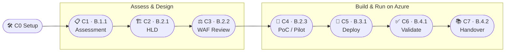

<!-- markdownlint-disable MD033 MD041 -->
<div align="center">

# 🖥️ AVD Module B MicroHack — *The Agentic Engagement*

**A 1-day, classroom-led, Train-the-Trainer MicroHack** that teaches Microsoft partner
consultants to deliver **every Azure Virtual Desktop Advanced Specialization *Module B*
control** using **GitHub Copilot custom agents, skills, and MCP servers** — end-to-end,
on real Azure, with Bicep **and** Terraform.

[](challenges/)
[](infra/)
[](.devcontainer/devcontainer.json)
[](LICENSE)

</div>

> [!IMPORTANT]
> This MicroHack is **derived from**, and stays aligned to, the
> [AVD Advanced Specialization toolkit](https://github.com/NikoMix/specialization-avd)
> (checklist **V2.7.1**). It teaches the *consulting engagement lifecycle* the auditor
> inspects — but accelerated with AI tooling. Every challenge produces a real **audit
> evidence artifact**.

---

## 🎯 What you build today

A single fictitious customer — **Contoso** — is migrating **~1,000 RDS/Citrix users**
(knowledge workers, a call centre, power users, and developers) to **Azure Virtual
Desktop**. Across 8 challenges you take Contoso from **discovery → design → review →
pilot → production → validation → handover**, exactly mirroring Module B, while a fleet
of **purpose-built Copilot agents** and **MCP servers** do the heavy lifting.



## 🧭 Challenge index

| # | Challenge | Module B control | Copilot agent | Key artifact |
|---|---|---|---|---|
| 00 | [Setup & guardrails](challenges/challenge-00-setup/) | — | `avd-engagement-lead` | Working Codespace, Azure login, **cost-cap budget** |
| 01 | [Workload assessment](challenges/challenge-01-workload-assessment/) | **B.1.1** | `avd-assessor` | Personas + app inventory + image strategy + sizing |
| 02 | [Solution design (HLD)](challenges/challenge-02-solution-design/) | **B.2.1** | `avd-architect` | Signed-off High-Level Design |
| 03 | [Well-Architected review](challenges/challenge-03-well-architected-review/) | **B.2.2** | `avd-waf-reviewer` | Cost/Perf/Reliability register |
| 04 | [PoC / Pilot](challenges/challenge-04-poc-pilot/) | **B.2.3** | `avd-pilot-lead` | Pilot scope, success criteria, go/no-go |
| 05 | [Deploy to production](challenges/challenge-05-deploy-to-production/) | **B.3.1** | `avd-deployment-engineer` | Live AVD via Bicep/Terraform AVM + Go-Live record |
| 06 | [Service validation](challenges/challenge-06-service-validation/) | **B.4.1** | `avd-test-engineer` | Logon/scaling/failover/FSLogix test results |
| 07 | [Handover documentation](challenges/challenge-07-handover-documentation/) | **B.4.2** | `avd-handover-writer` | LLD + runbook + hypercare + lessons learned |

## 🤖 The agentic toolkit

| Capability | What it is | Where |
|---|---|---|
| **Custom agents** | 8 AVD-specialist Copilot agents (one engagement lead + one per control) | [`.github/agents/`](.github/agents/) |
| **Skills** | Reusable, auto-activating AVD knowledge modules (FSLogix, sizing, WAF lens, cost guardrails, cutover…) | [`.github/skills/`](.github/skills/) |
| **MCP servers** | GitHub, **Azure**, Microsoft Learn, and Terraform Registry — give agents live tools & docs | [`.vscode/mcp.json`](.vscode/mcp.json) |
| **IaC** | AVD landing zone via **Azure Verified Modules**, Bicep **and** Terraform | [`infra/`](infra/) |

## 🚀 Quick start (learners)

1. **Open in Codespaces** — green **Code** button → **Codespaces** → *Create codespace on `main`*.
   Everything (az, azd, bicep, terraform, gh, Copilot CLI, node, pwsh, python) is pre-installed.
2. Set your `GH_TOKEN` (see [Challenge 00](challenges/challenge-00-setup/)).
3. `az login` to **your own** Azure subscription.
4. Start at **[Challenge 00](challenges/challenge-00-setup/)** and work the index above.

> 💸 **Cost matters.** Challenge 00 deploys a **budget + auto-shutdown** and uses small,
> teardownable SKUs. Run [`scripts/reset/`](scripts/reset/) at the end of the day —
> every challenge reminds you.

## 👩‍🏫 Trainers — start here

This is a **Train-the-Trainer** kit. Before you teach:

- 📖 [Facilitator guide](facilitator/facilitator-guide.md) — talk track, gotchas, what to demo live
- ⏱️ [Run of day](facilitator/run-of-day.md) — minute-by-minute timing for the 1-day flow
- 🧰 [Delivery checklist](facilitator/delivery-checklist.md) — prerequisites, subscription/quotas, dry-run
- 🗝️ [Solution keys](solutions/) — reference answers and completed artifacts per challenge
- 🖼️ [Slides](slides/) — Marp decks (one per module) rendered from Markdown
- 🧹 [Cost & cleanup](facilitator/cost-and-cleanup.md) — budgets, teardown, post-class verification

## 📚 Documentation site

The full course is also published as a searchable site (Astro + Starlight) via GitHub
Pages — see [`docs/`](docs/). Build locally with `cd docs && npm install && npm run dev`.

## 🗂️ Repository layout

```text
.devcontainer/   Codespaces image + tooling
.vscode/         MCP servers, recommended extensions, Copilot settings
.github/         Copilot agents, skills, instructions, CI, issue/PR templates
challenges/      The 8 hands-on challenges (00–07)
infra/           AVD landing zone — bicep/ and terraform/ (AVM)
scripts/         setup / load-test / validate / reset (PowerShell + Bash)
scenario/        Contoso data: personas, app inventory, MAP/Azure Migrate export
solutions/       Trainer answer keys per challenge
facilitator/     Train-the-Trainer guide, timings, troubleshooting
slides/          Marp slide decks
docs/            Starlight documentation site
```

## 🔐 Responsible & free-to-use

- **OSS / license-free only.** No paid vendor licences are required to run this MicroHack.
- **You own the cloud cost.** Labs deploy into *your* subscription; guardrails included but
  you are responsible for teardown.
- The scenario, personas, and "Contoso" data are **entirely fictitious**.

## 🤝 Contributing

See [CONTRIBUTING.md](CONTRIBUTING.md). Feedback per challenge → open an issue with the
**challenge-feedback** template. Lessons learned from real delivery are very welcome.

## 📄 License

[MIT](LICENSE) © NikoMix. Built to enable Microsoft partners pursuing the **Azure Virtual
Desktop Advanced Specialization**.
