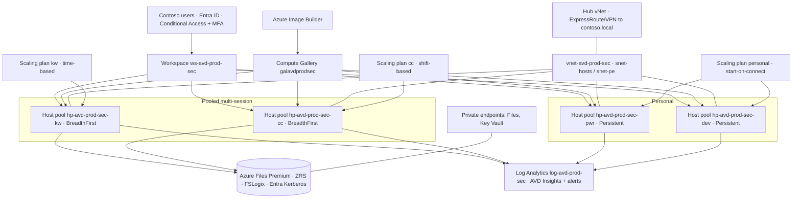

<!-- SOLUTION KEY (trainer reference) — control B.2.1 Solution Design (HLD).
     A worked example that reconciles with solutions/challenge-01/assessment.md and the
     infra/README.md contract. AVM versions verified 2026-06-27 (Terraform registry). -->
# Contoso AVD — High-Level Design (B.2.1)

> Author: AVD Engagement Team · Date: 2026-06-27 · Version: 1.0 (worked solution)

Implements the B.1.1 assessment ([`solutions/challenge-01/assessment.md`](../challenge-01/assessment.md))
and is consistent with the IaC contract in [`infra/README.md`](../../infra/README.md). Full Contoso
scale is a **paper design** (`env=prod`); the lab deploys the same modules at `env=lab` with 1–2
hosts.

## 1. Architecture overview

## 2. Design domains

### 2.1 Host pools & application groups

Four host pools (one per persona) under a single workspace `ws-avd-prod-sec`, so images, scaling,
and density are tuned independently:

| Host pool | Type | Persona | Load balancing | maxSessionLimit | App group(s) |
|---|---|---|---|---|---|
| `hp-avd-prod-sec-kw` | Pooled multi-session | Knowledge workers | BreadthFirst | 25 | `ag-…-kw-desktop` (Desktop) + `ag-…-kw-remoteapp` (Legacy Scanning App) |
| `hp-avd-prod-sec-cc` | Pooled multi-session | Call centre | BreadthFirst | 30 | `ag-…-cc-desktop` (Desktop) |
| `hp-avd-prod-sec-pwr` | Personal | Power users | Persistent (Automatic assignment) | n/a | `ag-…-pwr-desktop` (Desktop) |
| `hp-avd-prod-sec-dev` | Personal | Developers | Persistent (Automatic assignment) | n/a | `ag-…-dev-desktop` (Desktop) |

**BreadthFirst** for pooled spreads the morning logon storm across hosts (better UX than DepthFirst,
which concentrates load to save cost). `maxSessionLimit` equals the per-host density from the
assessment (25 KW / 30 CC). Each persona's Entra group is assigned **Desktop Virtualization User**
on its app group.

### 2.2 Identity

- **Default: Entra-joined session hosts + Intune** enrolment for all pools (no on-prem domain
  dependency for the host OS).
- **Conditional Access** on the AVD enterprise apps (*Azure Virtual Desktop* + *Windows Cloud
  Login*): require **MFA** + compliant/Entra-hybrid device; tuned sign-in frequency for sensitive
  groups.
- **RBAC (least privilege):** persona Entra groups → *Desktop Virtualization User* on app groups;
  operations → *Desktop Virtualization Contributor*; no standing owner. In the lab, `adminObjectId`
  (infra param) is granted app-group access.
- **FSLogix auth:** **Entra Kerberos** for Azure Files on Entra-joined hosts; storage RBAC *Storage
  File Data SMB Share Contributor* **plus** NTFS ACLs on the share.
- **Hybrid join — only where genuinely required:** the **LOB CRM** uses **smartcard** logon and an
  on-prem **SQL** back end. Default stays Entra join with **Entra Kerberos cloud trust** to
  `contoso.local`; the KW pool's LOB CRM/smartcard path is **validated in the pilot (B.2.3)** and we
  fall back to hybrid join for that pool **only** if cloud trust cannot satisfy it (see Decision 2).

### 2.3 Profiles (FSLogix)

- **Share:** Azure Files **Premium** `profiles` on storage account `stavdprodsec<unique>`, **ZRS**,
  **private endpoint** only (no public access), **Entra Kerberos**.
- **Capacity/IOPS:** provisioned **≥ 5 TiB** to cover 4,100 GB raw profile data + growth and the
  **peak-logon IOPS** of the 900 pooled users (≈ 5,120 baseline / ~15,360 burst IOPS). If the
  morning storm exceeds burst, **split KW and CC onto separate shares/accounts**. **ANF** only if
  pooled users exceed ~1,000 or latency demands it — **not** needed at 900.
- **Container config:** `VHDX`, `FlipFlopProfileDirectoryName=1`,
  `DeleteLocalProfileWhenVHDShouldApply=1`, `SizeInMBs` capped per persona (KW 5 GB / CC 3 GB).
- **Redirections:** `redirections.xml` for Teams/OneDrive caches; **OneDrive KFM** for known
  folders. **Cloud Cache: off** (single region — adds cost/complexity without active-active need).
- **Personal pools:** profile stays **local** on the persistent OS disk; FSLogix optional only for
  portability.
- **Backup:** share **snapshots** + Azure Backup (Backup vault); **restore tested** as a B.4.1 case.

### 2.4 Networking

- **Topology:** hub/spoke. Spoke `vnet-avd-prod-sec` with `snet-avd-hosts` (session hosts) and
  `snet-avd-pe` (private endpoints); NSGs per subnet; egress via the hub firewall.
- **RDP Shortpath (UDP):** enabled for a lower-latency, more resilient transport.
- **Private endpoints:** Azure Files and Key Vault; Private DNS zones
  `privatelink.file.core.windows.net` and `privatelink.vaultcore.azure.net`.
- **DNS:** Azure DNS + Private Resolver, with conditional forwarding to `contoso.local` during
  coexistence.
- **On-prem connectivity:** **ExpressRoute recommended** (LOB CRM SQL latency + migration data
  volume); **S2S VPN** acceptable as an interim (Decision 8).

### 2.5 Golden image

- **Pipeline:** **Azure Image Builder** → **Azure Compute Gallery** `galavdprodsec` (Trusted Launch,
  versioned, replicated to Sweden Central).
- **Definitions:** (1) multi-session (KW + CC), (2) personal (power), (3) personal-dev (developers,
  on a nested-virtualization-capable SKU).
- **Customisations:** **VDOT** (MIT-licensed OSS) optimisations, Teams AVD media optimization, M365
  Apps shared activation, language/region packs.
- **Cadence:** monthly patch + rebuild; out-of-band rebuild for critical CVEs. Platform team owns;
  dev → test → prod gallery promotion.

### 2.6 Scaling

| Scaling plan | Host pool(s) | Strategy |
|---|---|---|
| `sp-avd-prod-sec-kw` | KW | **Time-based**: ramp-up before 08:00 (morning storm), BreadthFirst during ramp-up, ramp-down evening, low off-peak minimum |
| `sp-avd-prod-sec-cc` | CC | **Shift-based**: schedules aligned to call-centre shifts; aggressive ramp-down off-shift/weekend |
| `sp-avd-prod-sec-personal` | Power, Dev | **Personal**: start-on-connect; deallocate on disconnect/idle after a grace period (cost control for the 100 personal VMs) |

### 2.7 Monitoring

- **Log Analytics** `log-avd-prod-sec` + **AVD Insights** workbook; diagnostic settings on host
  pools, app groups, workspace, and the storage account; DCRs for performance counters + event logs.
- **Alerts:** logon time **P95** above target, host availability/health, **FSLogix** errors, Files
  share IOPS/throttling, scaling-plan failures.

### 2.8 BCDR

- **Region:** primary **Sweden Central**; AVD metadata in a supported metadata region.
- **Profiles:** ZRS + snapshots + Backup vault. **RPO** = snapshot interval (target 4 h); **RTO** =
  redeploy hosts from the gallery via IaC (target < 4 h). Personal VM disks (power/dev) protected by
  **Azure Backup** (RPO daily).
- **Image/IaC resilience:** gallery replicated; the whole estate is reproducible from `infra/`
  (the image pipeline is therefore not a single point of failure for recovery).

## 3. AVM module map

Versions below are the **Terraform** AVM modules, **verified 2026-06-27** against the Terraform
Registry. (Bicep AVM modules on MCR track separately — pin those from the
[AVM index](https://azure.github.io/Azure-Verified-Modules/) / the `terraform` MCP at build time.)
`infra/` implements this map on both tracks.

| Domain | AVM module | Pinned version |
|---|---|---|
| Host pools (×4) | `desktop-virtualization/host-pool` | `0.4.0` |
| App groups (×5) | `desktop-virtualization/application-group` | `0.2.1` |
| Workspace | `desktop-virtualization/workspace` | `0.2.2` |
| Scaling plans (×3) | `desktop-virtualization/scaling-plan` | `0.2.1` |
| Virtual network | `network/virtual-network` | `0.19.0` |
| Storage (Files) | `storage/storage-account` | `0.7.3` |
| Key Vault | `key-vault/vault` | `0.10.2` |
| Log Analytics | `operational-insights/workspace` | `0.5.1` |
| Compute Gallery | `compute/gallery` | `0.2.0` |
| Session host VMs | `compute/virtual-machine` | `0.21.0` |

## 4. Decisions register

| # | Decision | Options considered | Choice | Justification |
|---|---|---|---|---|
| 1 | Pool model per persona | All pooled / all personal / mixed | KW+CC pooled, Power+Dev personal | Matches assessment: standardised+shareable → pooled; persistent/admin/nested-virt → personal |
| 2 | Host identity | Entra join / Hybrid join | **Entra join** default; hybrid only for KW pool **if** LOB CRM cloud-trust fails | Modernise identity; avoid AD dependency; retire the risk in the pilot |
| 3 | Profile storage | Azure Files Premium / ANF | **Files Premium** | 900 pooled users < ANF's ~1,000 threshold; Premium meets logon-storm IOPS |
| 4 | Files redundancy | LRS / ZRS / GRS | **ZRS** + snapshots + backup | Zone resilience for profiles without GRS cost; backup covers restore |
| 5 | FSLogix Cloud Cache | On / Off | **Off** | Single region; no active-active requirement to justify the cost/complexity |
| 6 | Pooled load balancing | BreadthFirst / DepthFirst | **BreadthFirst** | Spreads the morning logon storm; better UX than cost-concentrating DepthFirst |
| 7 | Host-pool granularity | One shared pool / per-persona pools | **Per-persona** | Independent image, density, and scaling per workload |
| 8 | On-prem connectivity | ExpressRoute / S2S VPN | **ExpressRoute** (VPN interim) | LOB CRM SQL latency + migration data volume favour ExpressRoute |
| 9 | Transport | TCP only / RDP Shortpath (UDP) | **RDP Shortpath** | Lower latency, more resilient remote experience |
| 10 | Personal-host cost control | Always-on / start-on-connect + deallocate | **Start-on-connect + deallocate** | Only ~78 of 100 personal VMs run at peak; large off-hours saving |

> These decisions are the inputs the WAF review (B.2.2) pressure-tests and the pilot (B.2.3)
> retires. Required design changes flow back into this HLD before any production host is built.
